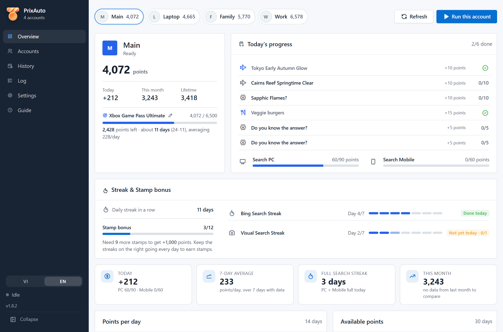
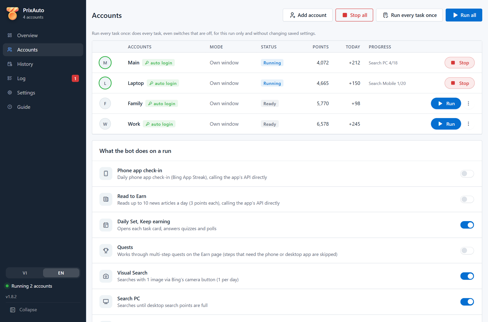
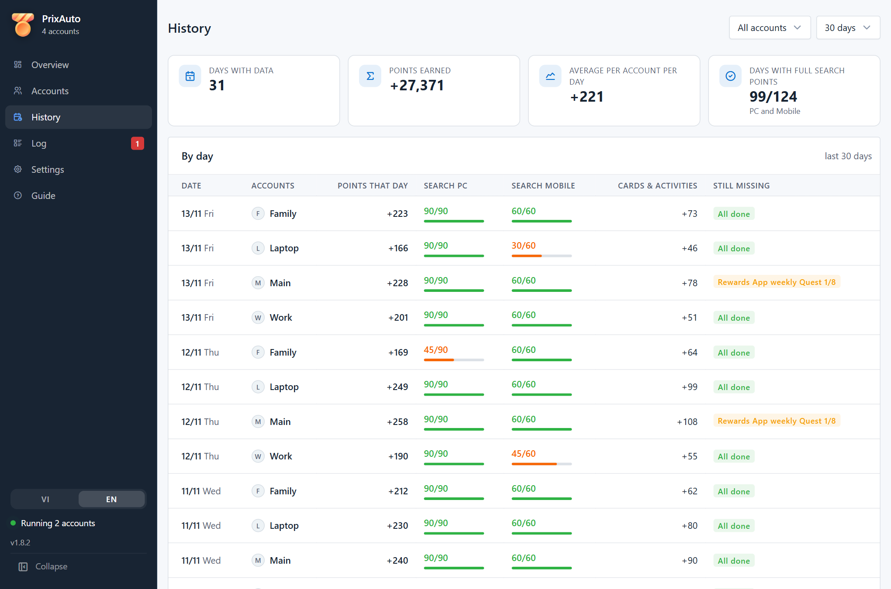
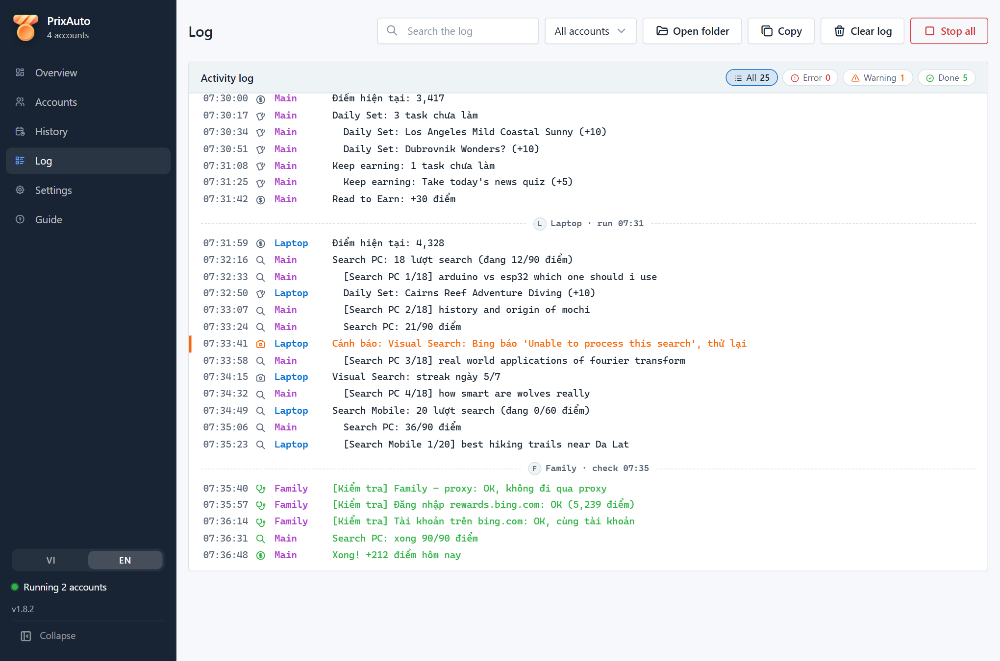
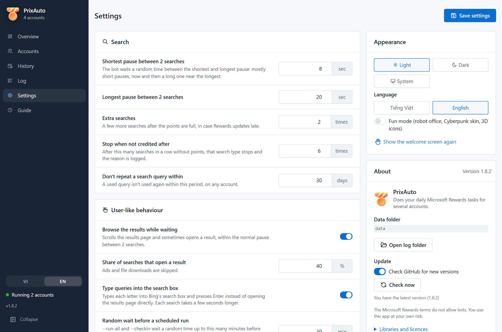
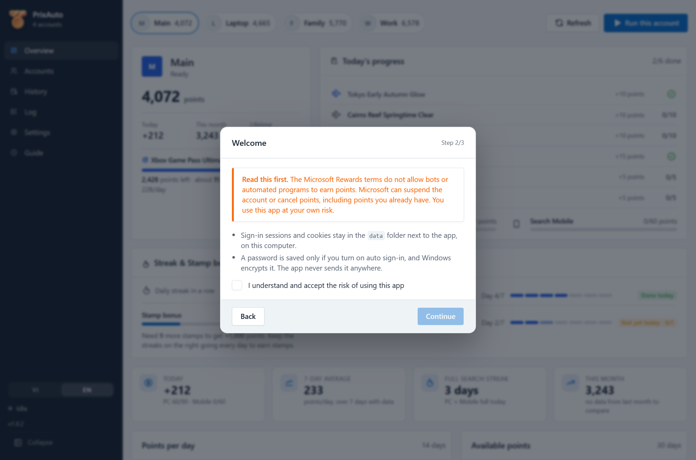
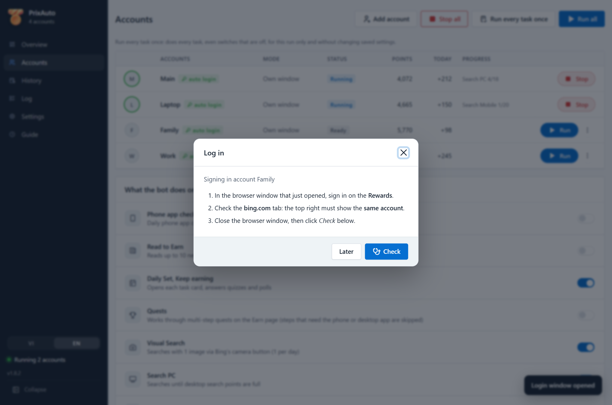
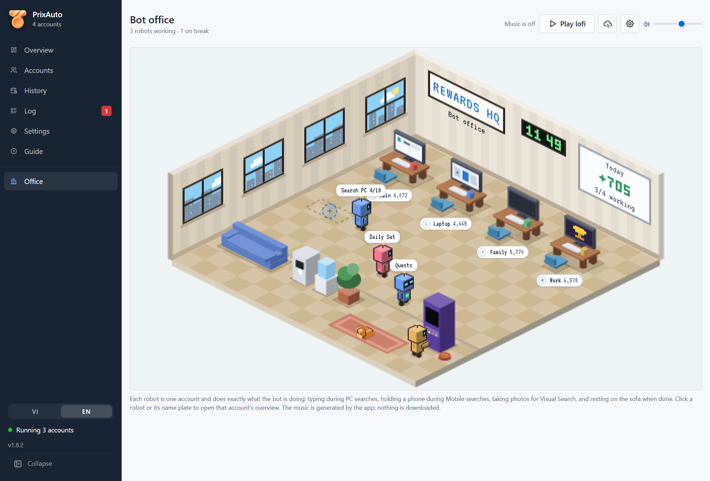
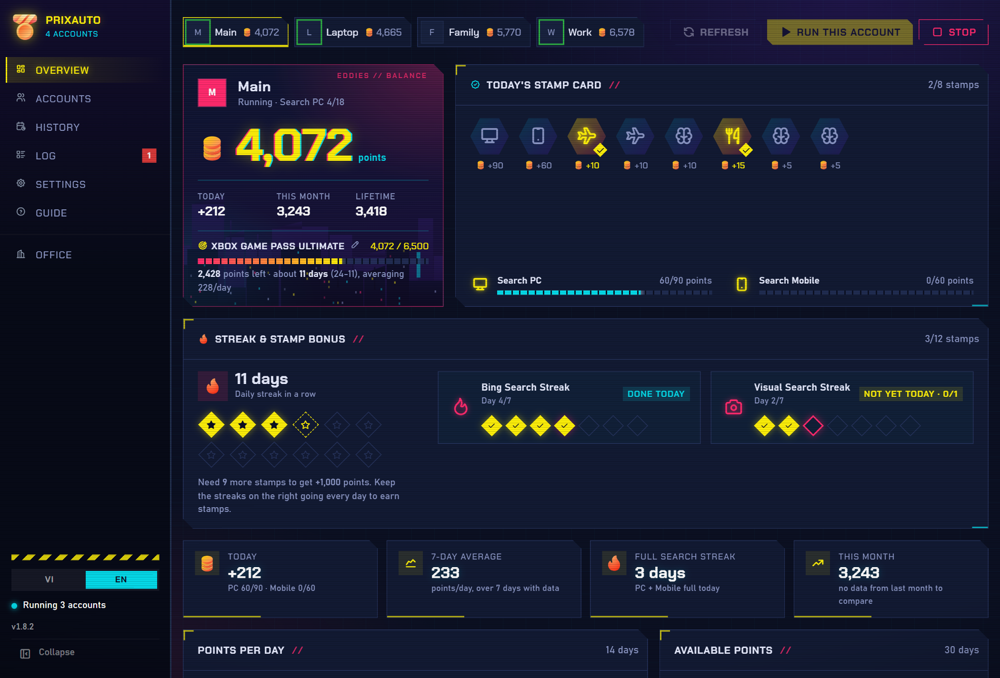
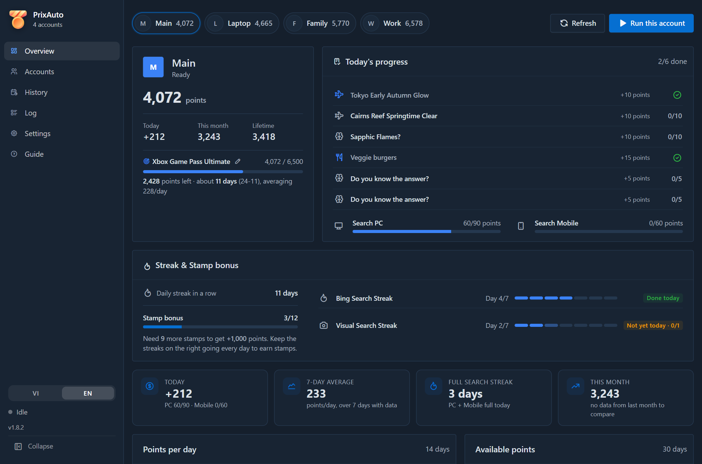

<div align="center">


# PrixAuto

**Your daily Microsoft Rewards tasks, done automatically for several accounts, from one desktop app.**

[](https://github.com/NT101-lc/reward-automation/releases/latest)
[](https://github.com/NT101-lc/reward-automation/releases)
[](LICENSE)


[**Download**](https://github.com/NT101-lc/reward-automation/releases/latest) ·
[Features](#features) ·
[Screenshots](#screenshots) ·
[Install](#install-on-windows-no-python-needed) ·
[FAQ](#faq) ·
[Tiếng Việt](README.md) ·
[Website](https://nt101-lc.github.io/reward-automation/)

<br>



</div>

<br>

> [!WARNING]
> **Read this first.** The Microsoft Rewards terms do not allow bots or automated tools to earn points. Microsoft can
> suspend the Rewards account and cancel unredeemed points or orders. This project is not affiliated with or endorsed by
> Microsoft. You use it entirely at your own risk; do not use it with an account you cannot afford to lose.

## Highlights

<table>
  <tr>
    <td width="33%" valign="top">
      <h4>Every daily task</h4>
      Daily Set, Keep earning, Quests, PC and Mobile searches, Visual Search, Read to Earn and the phone app check-in.
    </td>
    <td width="33%" valign="top">
      <h4>Many accounts in parallel</h4>
      Each account gets its own Edge profile and window, with a limit on how many run at once.
    </td>
    <td width="33%" valign="top">
      <h4>Human-like searches</h4>
      Types into the search box, pauses at random and scrolls the results; queries never repeat across accounts.
    </td>
  </tr>
  <tr>
    <td valign="top">
      <h4>Clear dashboard</h4>
      Points, today's progress, streaks, stamp bonus, daily charts and a reward goal with an ETA.
    </td>
    <td valign="top">
      <h4>Self-check with fixes</h4>
      Verifies sign-in, the bing.com account and the proxy, and says how to fix each problem. Wrong account, no searches.
    </td>
    <td valign="top">
      <h4>Your data stays local</h4>
      No telemetry. An optional saved password is encrypted by Windows and never written to the log.
    </td>
  </tr>
</table>

## Features

| Area | What the bot does |
|---|---|
| **Daily tasks** | Daily Set, Keep earning (links, polls, simple quizzes), multi-step Quests. A card that was done but not credited is retried once. |
| **Searches** | PC and Mobile searches until the points are full. Queries come from 22 topics (~2,600 real-looking sentences plus ~10,000 popular keywords), never repeated across accounts or within N days. Typed letter by letter with random pauses. |
| **Extras** | Visual Search, Read to Earn (10 articles, 30 points), phone app check-in (keeps the Bing App Streak), Browse (Edge – Minutes). Each one can be switched on or off. |
| **Several accounts** | Run in parallel, each in its own Edge profile and window, with an optional per-account proxy. *Run every task once* also does the tasks that are switched off. |
| **Tracking** | Per-account overview, a per-day history of what was earned and what is still missing, and a live log with error / warning filters and search. |
| **Self-check** | No searches: verifies sign-in, the bing.com account, the Points breakdown, the Edge profile and the proxy, with a fix for every problem. |
| **Auto sign-in** | Optional. The password is encrypted with Windows DPAPI. The bot stops at any verification step (code, Authenticator, CAPTCHA) instead of trying to pass it. |
| **Scheduling** | `--run-all --headless` and `--checkin` run without a window, for Windows Task Scheduler or cron. |
| **Updates** | Tells you when a new version is out, shows the changelog, downloads and installs it in one click (SHA-256 checked). |
| **Interface** | Light and dark theme, English and Vietnamese, keyboard accessible. Fun mode: a robot office and a Cyberpunk skin. |

## Screenshots

<table>
  <tr>
    <td width="50%" valign="top">
      
      <p align="center"><b>Accounts</b><br><sub>Run, stop and sign in each account; pick what the bot does on a run.</sub></p>
    </td>
    <td width="50%" valign="top">
      
      <p align="center"><b>History</b><br><sub>Points per day for every account, and what is still missing.</sub></p>
    </td>
  </tr>
  <tr>
    <td valign="top">
      
      <p align="center"><b>Log</b><br><sub>Live activity, error / warning filters, self-check results.</sub></p>
    </td>
    <td valign="top">
      
      <p align="center"><b>Settings</b><br><sub>Search pacing, human-like behaviour, appearance, updates.</sub></p>
    </td>
  </tr>
  <tr>
    <td valign="top">
      
      <p align="center"><b>First launch</b><br><sub>Pick a language, accept the risk, add your first account.</sub></p>
    </td>
    <td valign="top">
      
      <p align="center"><b>Sign in</b><br><sub>Three steps, then click Check to make sure everything works.</sub></p>
    </td>
  </tr>
  <tr>
    <td valign="top">
      
      <p align="center"><b>Fun mode: bot office</b><br><sub>Each robot is an account, acting out what the bot is doing.</sub></p>
    </td>
    <td valign="top">
      
      <p align="center"><b>Fun mode: Cyberpunk</b><br><sub>Stamp card, neon icons, its own font.</sub></p>
    </td>
  </tr>
</table>

<details>
<summary><b>Dark theme</b></summary>
<br>

</details>

## Install on Windows (no Python needed)

The download is a ready-to-run app: **no Python or anything else to install**. You need Windows 10/11 (64-bit),
Microsoft Edge (built in) and a Microsoft account that has joined [Microsoft Rewards](https://rewards.bing.com).

1. **Download.** On the [latest release](https://github.com/NT101-lc/reward-automation/releases/latest) page, under
   **Assets**, click the file ending in **`-win64.zip`**. Not *Source code (zip)*: that needs Python.
2. **Unzip.** Right-click the zip → **Extract All...**, type `C:\PrixAuto`, click **Extract**. Do not run the app from
   inside the zip (it cannot save your accounts). Avoid `C:\Program Files` (not writable) and OneDrive-synced folders
   such as Desktop or Documents (your sign-in cookies would be uploaded).
3. **Open** `C:\PrixAuto\PrixAuto.exe`. Windows may show *"Windows protected your PC"* because the exe is not
   code-signed: click **More info → Run anyway**. If your antivirus removes the file, add `C:\PrixAuto` as an exception
   and unzip again. The welcome screen asks for your language, the risk acknowledgement and your first account.
4. **Sign in, once per account.** On the **Accounts** page, click **⋮ → Log in**. An Edge window opens with two tabs:
   sign in on the Rewards tab, check that the **bing.com** tab shows the **same account** (top right), then close the
   window.
5. **Check and run.** Click **⋮ → Check**; any **FAIL** line in the **Log** page says how to fix it. Then click **Run**
   (one account) or **Run all**. A run usually takes 20–40 minutes per account because searches are paced like a person.

All data (accounts, sign-in sessions, settings, history) stays in the `data\` folder next to `PrixAuto.exe`.

## Run it every day

The app has no schedule button yet; use Windows' own **Task Scheduler**:

1. Press **Start**, type `Task Scheduler`, open it, then click **Create Basic Task...** and name it `PrixAuto`.
2. Choose **Daily** and a time when the PC is usually on.
3. Choose **Start a program**. **Program/script**: `C:\PrixAuto\PrixAuto.exe`. **Add arguments**:
   `--run-all --headless`. **Start in**: `C:\PrixAuto`.
4. Tick **Open the Properties dialog...**, click **Finish**, and on the **Settings** tab tick **Run task as soon as
   possible after a scheduled start is missed**.

The task only runs while the PrixAuto window is closed and you are signed in to Windows. Right-click the task → **Run**
to test it. Results appear on the **History** and **Log** pages.

## Run from source

Only needed if you want to change the code. Install **Python 3.10+** from
[python.org](https://www.python.org/downloads/) and tick **"Add python.exe to PATH"** in the installer. Then:

```bash
git clone https://github.com/NT101-lc/reward-automation.git
```
```bash
cd reward-automation
```
```bash
pip install -r requirements.txt
```
```bash
python -m rewards_bot
```

| Command | What it does |
|---|---|
| `python -m rewards_bot` | Opens the app (only one window at a time) |
| `python -m rewards_bot --run-all --headless` | Runs every account without a window |
| `python -m rewards_bot --check` | Self-checks every account, no searches |
| `python -m rewards_bot --checkin` | Only the phone app check-in, for every account |
| `--now` | Add to `--run-all` / `--checkin` to start right away instead of after a random wait |

On Windows you can also double-click `scripts/run.bat`.

<details>
<summary><b>Linux</b></summary>

The bot and the headless mode work on Linux. You need:

1. Python 3.10+ and `pip install -r requirements.txt`.
2. A Chromium-based browser: **Microsoft Edge** (`microsoft-edge-stable`, recommended), Google Chrome or Chromium.
   Pick Chrome/Chromium in Settings if you use one of those.
3. For the UI only, a web view for pywebview: GTK (`sudo apt install python3-gi gir1.2-webkit2-4.1`) or Qt
   (`pip install "pywebview[qt]"`).

```bash
./scripts/run.sh
```
```bash
./scripts/run.sh --run-all --headless
```

Daily with cron: `30 7 * * * cd /path/to/reward-automation && ./scripts/run.sh --run-all --headless`.
On Linux `data/` is not locked down automatically (`chmod 700 data` if needed) and the system proxy is not read.
</details>

## Updating

When a new version is tagged on GitHub, the app shows a bar at the top. Click **What's new** to read the changelog, then
**Update now**: the app downloads the new version, checks its SHA-256 and restarts to install it. Accounts, settings and
sessions are kept. Turn the automatic check off, or click **Check now**, in **Settings → About**.

Manual update: download the new zip and unzip it over the old folder: the zip has no `data\` folder, so your accounts and
sessions are kept. From source: `git pull`.

Upgrading from the old **RewardsBot** name: copy the `data\` folder from next to `RewardsBot.exe` to next to
`PrixAuto.exe`, and point your scheduled task at `PrixAuto.exe`.

## FAQ

<details>
<summary><b>The app window is blank or closes right away</b></summary>

The app needs the **Microsoft Edge WebView2 Runtime**. Windows 11 has it; some older Windows 10 PCs do not. Install the
*Evergreen Bootstrapper* from [Microsoft's WebView2 page](https://developer.microsoft.com/microsoft-edge/webview2/) and
open the app again. If it still fails, see `data\crash.log`.
</details>

<details>
<summary><b>Mobile searches give 0 points</b></summary>

Run **Check**. Make sure the bing.com tab is signed in to the same account as Rewards. The bot clears Bing's session
cookies before the mobile tab, because otherwise Bing counts every search in that session as PC.
</details>

<details>
<summary><b>"Edge – Minutes" stays at 0/30</b></summary>

Edge measures browsing time itself and reports it to Rewards. Browse often needs to run 3–4 times in a day before it
fills up; turn off "auto stop" for Browse in that case. The log records the minutes before and after every 10 minutes.
</details>

<details>
<summary><b>Visual Search says "Unable to process this search"</b></summary>

Bing throttles Visual Search after many attempts on one account in a day. The bot tries at most 4 times per day
(configurable in Settings).
</details>

<details>
<summary><b>The bot says the profile is in use</b></summary>

An Edge window is still open on that account's profile. Close it (or stop the run) and try again. One profile can be
opened by one browser at a time.
</details>

<details>
<summary><b>Where are the logs?</b></summary>

In `data\logs\<date>.log` (kept 14 days by default). The **Log** page has an *Open folder* button. If the exe fails
to start, see `data\crash.log`. Please attach the log when you open an issue.
</details>

## Privacy and security

- Everything stays on your computer. The app has no telemetry. The update check only reads the public tag and release list on
  GitHub (you can turn it off in Settings). The bot's browser opens Bing and
  Rewards, plus the pages that Browse and the occasional search-result click visit.
- `data\` holds your Microsoft sign-in cookies. On Windows it is locked to your user account and SYSTEM on first run.
  Never share it.
- The browser runs with `--no-proxy-server` by default, so a system proxy cannot sit in the middle (turn this off in
  Settings if your network requires a proxy). Per-account proxies are supported (`http`, `https`, `socks4`, `socks5`,
  without credentials).
- Managed windows open Edge with a debug port bound to `127.0.0.1` only, which closes with the browser. Other programs
  on the same computer can control that window while it runs, so do not run the bot on a shared PC.
- The UI has a strict Content-Security-Policy: only the app's own scripts run, and all vendored libraries ship with
  the app (no CDN).

## Development

```bash
pip install -r requirements-dev.txt
```
```bash
python -m pytest -q tests
```

The UI smoke tests render every page in headless Edge with a mocked API.

Releases: bump `__version__` in `rewards_bot/__init__.py`, then push a tag `v<version>`. GitHub Actions runs the tests,
builds `PrixAuto.exe` and publishes the zip with its `.sha256`. Build locally with `python packaging/build_exe.py`.

<details>
<summary><b>Project layout</b></summary>

```
rewards_bot/
├── __main__.py           entry point: UI, --run-all, --check
├── cli.py                --run-all / --check without a window
├── core/
│   ├── bot.py            one account: tasks, searches, self-check
│   ├── rewards_page.py   parses rewards.bing.com (points, cards, Points breakdown)
│   ├── runner.py         runs accounts in parallel, daily log files
│   ├── edge_launcher.py  starts a normal Edge with a local debug port for Playwright
│   ├── browser.py        finds a leftover Edge still holding a profile folder
│   ├── instance.py       single-instance lock (data/app.lock)
│   ├── credentials.py    optional auto sign-in, DPAPI-encrypted
│   ├── security.py       data folder permissions, proxy and debug-port checks
│   └── config.py         settings and atomic JSON writes
├── search/               query catalog and no-repeat query bank
└── ui/                   pywebview app + web UI (Tabler, ApexCharts, vendored)
packaging/                PyInstaller build (PrixAuto.exe)
scripts/                  run.bat / run.sh (open the app), check.bat / check.sh (tests)
tests/                    pytest: bot logic, page parsing, API and UI smoke tests
docs/images/              README screenshots
```
</details>

## Credits and license

PrixAuto is released under the [MIT License](LICENSE). Bundled libraries keep their own licenses (see each folder in
`rewards_bot/ui/web/vendor/`): Tabler and Tabler Icons (MIT), ApexCharts (MIT), Fluent Emoji (MIT), Chakra Petch
(SIL OFL 1.1). The plain-Edge launch idea comes from [AutoRewarder](https://github.com/safarsin/AutoRewarder) (MIT).

"Microsoft", "Bing", "Edge" and "Microsoft Rewards" are trademarks of Microsoft Corporation. This project is not
affiliated with Microsoft.
